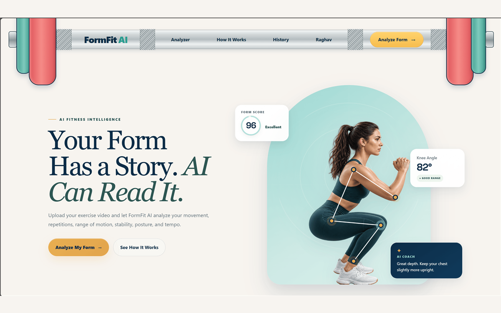
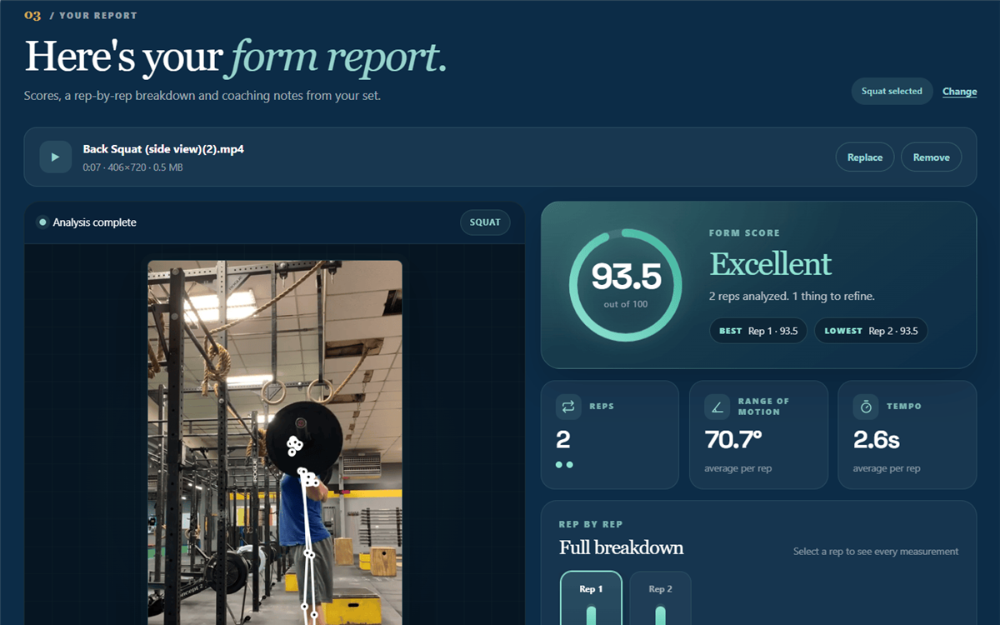
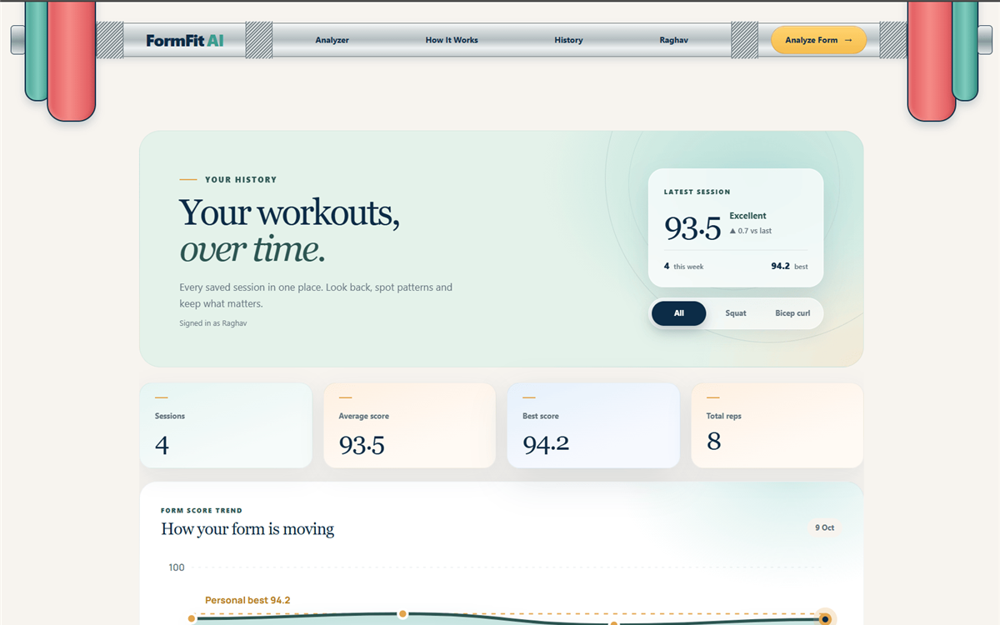
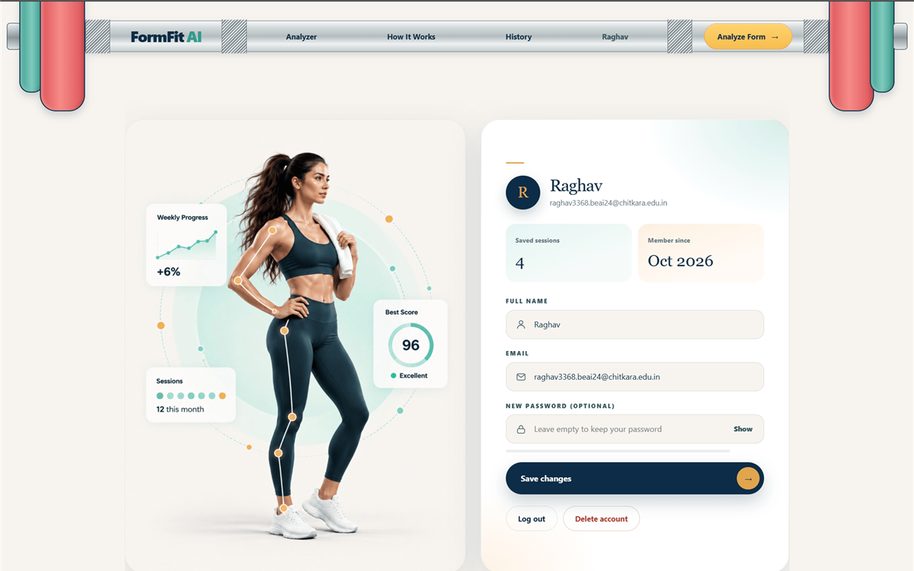
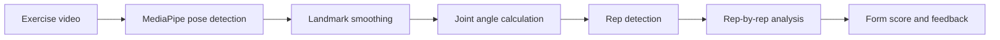

<div align="center">

# FormFit

### AI-powered exercise form analyzer

*Upload a workout video and get rep-by-rep feedback on your technique, right in your browser.*

<br>


<br>

[**GitHub repository**](https://github.com/Navjot192006/Formfit) &nbsp;|&nbsp; [**Features**](#features) &nbsp;|&nbsp; [**Run locally**](#running-locally) &nbsp;|&nbsp; [**Guidelines checklist**](#guidelines-checklist)

</div>

---

## Table of Contents

1. [About the Project](#about-the-project)
2. [Features](#features)
3. [Screenshots](#screenshots)
4. [How It Works](#how-it-works)
5. [How Scoring Works](#how-scoring-works)
6. [Form Insights](#form-insights)
7. [Tech Stack](#tech-stack)
8. [Data Storage](#data-storage)
9. [CRUD Operations](#crud-operations)
10. [Guidelines Checklist](#guidelines-checklist)
11. [Pages](#pages)
12. [Project Structure](#project-structure)
13. [Running Locally](#running-locally)
14. [Responsive Design](#responsive-design)
15. [Limitations](#limitations)
16. [Author](#author)

---

## About the Project

When exercising without a trainer, it is hard to tell whether an exercise is being done with proper technique.

**FormFit** is a web application that analyzes recorded exercise videos using computer vision and pose estimation. It detects each repetition and evaluates:

- **Range of motion**
- **Body and joint stability**
- **Posture**
- **Movement tempo**
- **Exercise-specific form**

Currently supported exercises: **squats** and **bicep curls**.

> **Privacy:** all analysis runs in your browser. Your videos are never uploaded anywhere.

---

## Features

| | Feature | Details |
|---|---|---|
| 🎥 | **Video analysis** | Upload a side-view video and get a form score, rep count, range of motion and tempo |
| 🔍 | **Rep-by-rep breakdown** | Radar chart, score bars, tempo split, joint measurements and coach notes for every rep, plus a "Watch this rep" playback |
| 💾 | **Save workouts** | Save any analysis to your history with one click |
| 🧠 | **Form insights** | A radar profile of your strengths, a 12-week consistency calendar with streaks, trend charts, a written coach summary and a downloadable report card |
| 📈 | **History page** | Summary stats, a form-score trend chart, an exercise filter, and edit and delete for each session |
| 👤 | **Accounts** | Sign up, log in with an optional "Remember me", edit your profile, log out and delete your account |
| 🔐 | **Google sign-in** | Create an account or log in with one click using "Continue with Google" |
| 🧑‍🏫 | **Coach Hub administration** | Teacher accounts can review users and workouts, edit account names/emails, and delete other accounts |
| 🧑‍🤝‍🧑 | **Guest mode** | Analyze and save workouts without an account; they move into your account when you sign up or log in |
| 🔔 | **Pop-up messages** | Friendly confirmations after saving changes, logging in and logging out |
| 📱 | **Responsive design** | Layouts for mobile, tablet and desktop |

---

## Screenshots

<table>
  <tr>
    <td width="50%" align="center">
      <br>
      <sub><b>Home</b></sub>
    </td>
    <td width="50%" align="center">
      <br>
      <sub><b>Analyzer results</b></sub>
    </td>
  </tr>
  <tr>
    <td width="50%" align="center">
      <br>
      <sub><b>History</b></sub>
    </td>
    <td width="50%" align="center">
      <br>
      <sub><b>Account</b></sub>
    </td>
  </tr>
</table>

---

## How It Works



1. The user uploads an exercise video.
2. The video is processed frame by frame.
3. MediaPipe Pose Landmarker detects body landmarks.
4. Landmark data is smoothed to reduce frame-to-frame noise.
5. Joint angles and movement information are calculated.
6. Exercise-specific logic detects completed repetitions.
7. Each detected repetition is analyzed.
8. A form score and feedback are generated.

---

## How Scoring Works

Each repetition receives a **form score from 0 to 100**. The overall score is the average of all reps.

**Squat**

| Component | Weight | What it measures |
|---|---|---|
| Depth | 45% | Knee angle and how far the hips descend, relative to thigh length |
| Torso control | 25% | Forward lean of the torso |
| Hip position | 15% | Hip angle through the movement |
| Bottom stability | 15% | How steady the knee angle stays at the bottom of the rep |

**Bicep curl** is scored on elbow stability, torso control, total range of motion and tempo.

| Score | Verdict |
|---|---|
| 90 and above | Excellent |
| 75 to 89 | Good |
| 60 to 74 | Fair |
| Below 60 | Needs work |

---

## Form Insights

The Insights page turns your saved workouts into a clear picture of your progress. It requests saved sessions from the REST API and calculates the charts and summaries in the browser.

| Block | What it shows | How it is calculated |
|---|---|---|
| **Form profile** | A radar chart of your average scores | Latest 5 sessions (solid) compared with earlier sessions (dashed) |
| **Strongest / Focus next** | Your best and weakest area with a tip | Highest and lowest of the four average scores |
| **Consistency** | A 12-week calendar and your streaks | Best score per day; the current streak counts back from today or yesterday |
| **Trends** | Line charts for form score and each area | Average of the latest 3 sessions against the 3 before |
| **Coach summary** | A short written summary | Rule-based sentence templates filled with your numbers |
| **Report card** | A downloadable image of your progress | Drawn on an HTML canvas and saved as a PNG |

---

## Tech Stack

| Layer | Technology |
|---|---|
| Markup | HTML5 |
| Styling | CSS3: custom properties, Flexbox, Grid, media queries, animations |
| Logic | Vanilla JavaScript: ES modules, async/await |
| Backend | Node.js HTTP server and REST endpoints |
| Database | PostgreSQL through `pg` when `DATABASE_URL` is set; local SQLite otherwise |
| Pose estimation | MediaPipe Pose Landmarker (runs in the browser) |
| Passwords | Server-side PBKDF2, SHA-256, random salt |
| Sessions | Random server-side sessions in HttpOnly, SameSite cookies |
| Social sign-in | Google Identity Services; credentials are verified by the server |

The frontend uses no framework or build step. The backend uses Node.js built-in modules plus `pg` for PostgreSQL connections.

---

## Data Storage

| Storage type | Name | Used for |
|---|---|---|
| **PostgreSQL** | Configured by the server-only `DATABASE_URL` in `.env` | Hosted accounts, sessions, workouts, rep results, and video metadata |
| **SQLite** | `server/data/formfit.sqlite` | Local development mode when `DATABASE_URL` is not configured |
| **HttpOnly cookie** | `ff_session` | Opaque session token; the server stores only its SHA-256 hash |
| **localStorage** | `ff_current_user` | Public profile cache for the interface; never used to authorize API requests |
| **localStorage** | `ff_settings` | History filter and the exercise chosen on the Insights page |
| **sessionStorage** | `ff_flash` | One-time pop-up message passed between pages |

Both database schemas relate workouts to users and rep results to workouts. They enforce score, exercise, length, and ownership constraints, and index workout history by owner and date. The `video_assets` table stores video metadata and a private storage key; video bytes are not stored in PostgreSQL. Guest sessions receive a private server-side owner ID; signing in adopts that browser's guest workouts into the account.

The app uses SQLite for a simple local run. Set `DATABASE_URL` to a PostgreSQL connection URI to make the Node.js API use PostgreSQL instead. Keep the URI in `.env` on the server and out of browser code and source control.

To copy the existing SQLite accounts, sessions, workouts, rep results, and video metadata to an empty PostgreSQL database, stop the running app, configure `.env`, install dependencies, and run `npm.cmd run migrate:postgres`. The command keeps the SQLite file as a backup and stops if the PostgreSQL tables already contain rows. Migrate before creating a new PostgreSQL-only teacher account.

Old browser-only accounts can be upgraded by logging in with the existing email and password. Their workouts are imported after login or signup. This import can read browser storage only from the same host and port; the old browser records remain available as a local backup.
---

## CRUD Operations

**Workouts (REST API + PostgreSQL or SQLite)**

| Operation | Where |
|---|---|
| **Create** | `POST /api/workouts`, called by "Save workout" |
| **Read** | `GET /api/workouts` and `GET /api/workouts/:id`, used by History and Insights |
| **Update** | `PATCH /api/workouts/:id`, used to edit a session's title and notes |
| **Delete** | `DELETE /api/workouts/:id`, used by the History page |

**User accounts (REST API + PostgreSQL or SQLite)**

| Operation | Where |
|---|---|
| **Create** | `POST /api/auth/signup` |
| **Read** | `POST /api/auth/login` and `GET /api/auth/me` |
| **Update** | `PATCH /api/auth/profile` |
| **Delete** | `DELETE /api/auth/account`; workouts and sessions cascade with the account |

Teacher-only account management is available through `PATCH /api/admin/users/:id` and `DELETE /api/admin/users/:id`. The Coach Hub lets a teacher edit another profile's name/email or remove that account and its saved data. The signed-in teacher cannot delete their own account from Coach Hub; use the Account page for that.

All state-changing requests reject a mismatched browser origin. The API validates request fields, uses parameterized SQL statements, checks ownership on every workout operation, and returns structured errors with HTTP status codes.

Workout creation and signup return `201`; reads, updates, Google sign-in, and legacy imports return `200`; successful deletes return `204`. Invalid data returns `400`, unauthenticated account requests return `401`, unsupported methods return `405`, duplicate emails return `409`, and missing or non-owned workouts return `404`.

---

## API Endpoints

| Method | Path | Purpose |
|---|---|---|
| `GET` | `/api/health` | Health check |
| `POST` | `/api/auth/signup` | Create an account and session |
| `POST` | `/api/auth/login` | Verify credentials and create a session |
| `POST` | `/api/auth/google` | Verify a Google ID token server-side |
| `GET` | `/api/auth/me` | Read the current account |
| `GET` | `/api/admin/users` | Teacher-only view of registered users and saved workout records |
| `PATCH` | `/api/admin/users/:id` | Teacher-only update of a user's name or email |
| `DELETE` | `/api/admin/users/:id` | Teacher-only deletion of another user's account and associated data |
| `POST` | `/api/auth/logout` | Revoke the current session |
| `PATCH` | `/api/auth/profile` | Update account details |
| `DELETE` | `/api/auth/account` | Delete account and owned data |
| `GET`, `POST`, `DELETE` | `/api/workouts` | List, create, or clear owned workouts |
| `POST` | `/api/workouts/import` | Safely import old browser workouts once |
| `GET`, `PATCH`, `DELETE` | `/api/workouts/:id` | Read, edit, or delete one owned workout |

---

## Guidelines Checklist

| Requirement | Status | Where |
|---|---|---|
| HTML, CSS and JavaScript tech stack | ✅ | No frameworks; plain HTML, CSS and JS modules |
| Features covered in class | ✅ | DOM manipulation, events, forms and validation, Flexbox, Grid, media queries, animations, async/await, ES modules |
| Responsive for mobile, tablet and desktop | ✅ | Breakpoints at about 1200px, 950px and 600px |
| At least 2 pages | ✅ | Home, History, Login, Signup and Account |
| REST API and frontend integration | ✅ | See [API Endpoints](#api-endpoints) |
| Teacher-only account administration | ✅ | Admin API checks the server-side teacher role; Coach Hub supports profile edits and account deletion |
| Database schema, relations, constraints, and indexes | ✅ | PostgreSQL and SQLite schemas in `server/database.cjs` |
| Backend validation, security, and tests | ✅ | Server checks and `npm test` |
| CRUD operations | ✅ | See [CRUD Operations](#crud-operations) |
| Responsive design and accessibility | ✅ | Responsive breakpoints, labels, live status messages, and keyboard focus styles |
| Code on GitHub with commits on different days | ✅ | See the repository's commit history |
| Project details in README.md (Markdown) | ✅ | This file |

---

## Pages

| Page | Purpose |
|---|---|
| `index.html` | Landing page and the video analyzer |
| `history.html` | Saved workouts, stats and trend chart |
| `insights.html` | Form insights: profile, consistency, trends and report card |
| `login.html` | Log in |
| `signup.html` | Create an account |
| `account.html` | Profile, log out and delete account |
| `coach-hub.html` | Teacher dashboard for reviewing users and managing accounts |

---

## Project Structure

<details>
<summary><b>Click to expand the folder tree</b></summary>

```text
FitnessAI/
├── index.html           # Landing page + analyzer
├── history.html         # Workout history
├── insights.html        # Form insights
├── login.html           # Log in
├── signup.html          # Sign up
├── account.html         # Account page
├── coach-hub.html       # Teacher-only database overview
├── teacher.css          # Teacher dashboard styles
├── teacher.js           # Teacher dashboard data and rendering
├── style.css            # Main styles
├── history.css          # History page styles
├── insights.css         # Insights page styles
├── auth.css             # Login / signup / account styles
├── script.js            # Analyzer controller
├── state.js             # Shared analyzer state
├── constants.js
├── db.js                # Frontend API client and legacy data migration
├── server/
│   ├── app.cjs           # REST API and static-file server
│   ├── database.cjs      # SQLite and PostgreSQL schemas and query adapters
│   ├── migrate-sqlite-to-postgres.cjs # Preserves local data during migration
│   └── create-teacher.cjs # Creates or promotes a teacher account
├── tests/
│   └── api.test.cjs      # Backend CRUD, validation, auth, and ownership tests
├── history.js           # History page logic
├── insights.js          # Insights page interface
├── insights-data.js     # Insights calculations (profile, trends, heatmap, streaks)
├── auth.js              # Login / signup / account logic
├── nav-auth.js          # Navbar login state + pop-up messages
├── core/                # Pose model setup, video processing, drawing
├── detection/           # Rep detection and side-view check
├── analysis/            # Per-rep form analysis
├── geometry/            # Angle calculation
├── landmarks/           # Landmark smoothing
├── models/              # MediaPipe pose model
└── assets/              # Images
```

</details>

---

## Running Locally

Install Node.js 22.13 or newer. Run the frontend and API together so the browser can send same-origin session cookies.

```bash
# Windows PowerShell
npm.cmd start

# macOS / Linux
npm start
```

For the simplest setup, open the URL printed in the terminal (by default, `http://127.0.0.1:5501/signup.html`). Keep the API server running while using the app. If startup says the port is already in use, the server may already be running; do not start a second copy.

To use VS Code Live Server, keep the API server running on port `5501`, then open `index.html` with Live Server on `http://127.0.0.1:5500`. The frontend automatically sends API requests to port `5501`; the backend allows this local development origin and includes session cookies. The Live Server page and API server must use the same host spelling (`127.0.0.1` on both).

Without a `.env` file, SQLite is created automatically at `server/data/formfit.sqlite`. To enable PostgreSQL:

```powershell
Copy-Item .env.example .env
npm.cmd install
```

Put your PostgreSQL connection URI in `.env` as `DATABASE_URL=...`. A hosted provider such as Neon can supply this URI; use its pooled connection string and keep the password private. Then stop the app and copy existing local data with:

```powershell
npm.cmd run migrate:postgres
```

Start the API again with `npm.cmd start`. When `DATABASE_URL` is set, the app creates or updates its PostgreSQL tables on startup and uses PostgreSQL. If it is absent, the app stays in local SQLite mode. Never put the connection string in frontend files or commit `.env`.

The PostgreSQL schema includes a `video_assets` metadata table for a later video-storage feature. Actual video files need private object storage such as S3 or compatible storage; this project does not upload video files to PostgreSQL yet.

To create a separate teacher login, run `npm.cmd run create:teacher` in PowerShell. Enter the name, email and a password when prompted. The password is saved as a server-side hash. If the email already belongs to an account, the command asks you to confirm before promoting it and resetting its password. Give the teacher the email and password you chose, then have them sign in at `http://127.0.0.1:5501/login.html`. The teacher can manage other accounts from Coach Hub. Passwords, password hashes and session tokens are never returned.

Run the API tests with:

```bash
npm test
```

Do not open `index.html` directly from the file system. When using another static server, use the Live Server setup above so the API can receive requests.

---

## Responsive Design

The layout adapts at three main breakpoints (about 1200px, 950px and 600px). On smaller screens the navbar collapses into a menu, card grids stack, and the login and signup artwork is hidden.

---

## Limitations

- SQLite is local to this server instance. For a hosted deployment, configure PostgreSQL and host the Node.js API; keep video bytes in private object storage rather than in the relational database.
- Use HTTPS in production so the server can mark session cookies `Secure`.
- Google sign-in requires network access to Google's token verification endpoint.
- Insights are calculated from your saved sessions, so they need a few workouts (ideally on different days) to be meaningful. The coach summary is written from rules and templates, not machine learning.
- Clearing site data removes the public profile/settings cache and the browser's session cookie; account and workout records remain in the configured server database.
- Analysis works best with a clear **side-view** video where the whole body is visible.
- Only squats and bicep curls are supported; other exercises on the page are marked "Coming soon".
- The numbers shown in the home-page previews are sample data.

---

## Author

**Navjot Singh**  
GitHub: [@Navjot192006](https://github.com/Navjot192006)

Pose estimation is powered by [MediaPipe](https://developers.google.com/mediapipe) from Google.

## License

Released under the [MIT License](LICENSE).

<div align="center">

<br>

*Train with more awareness.*

</div>
